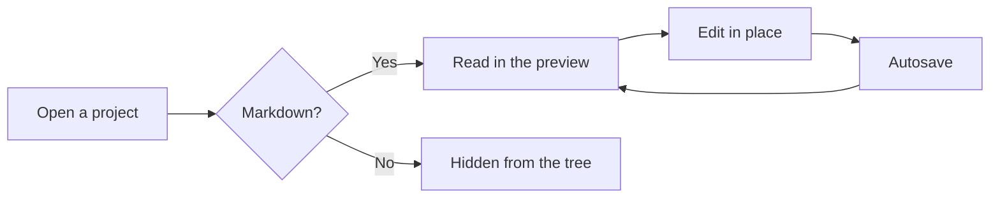
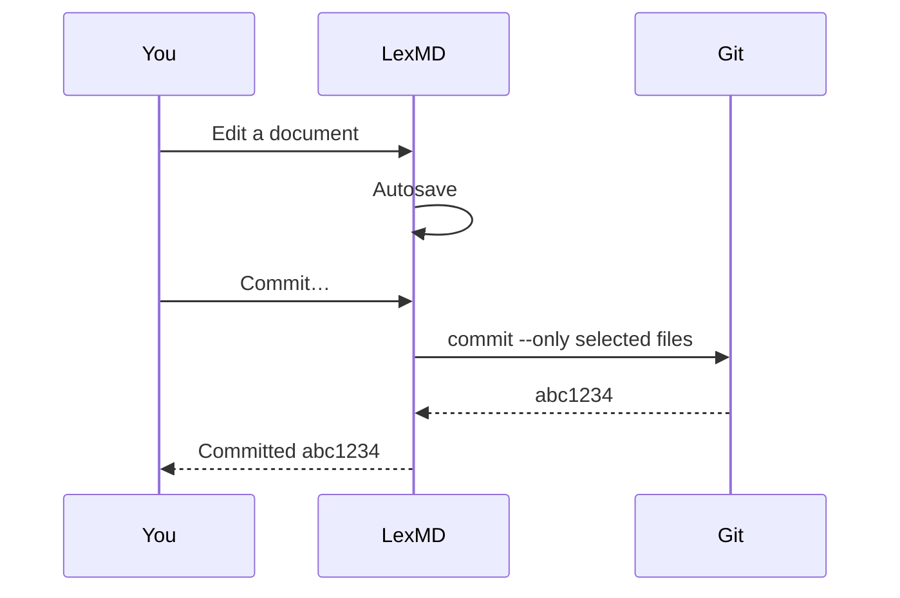
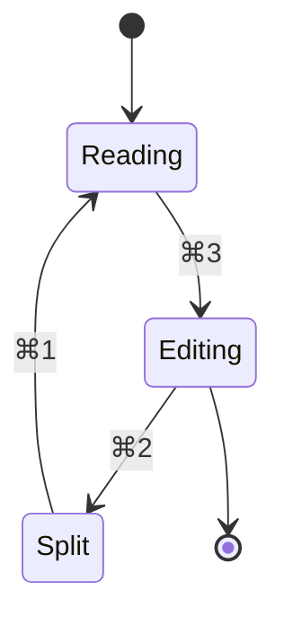
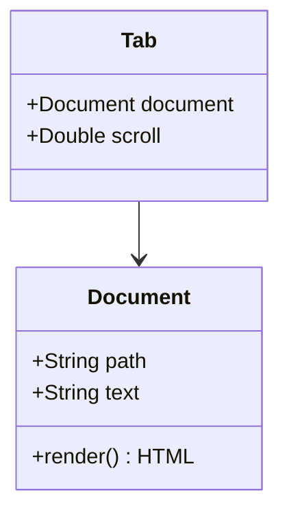
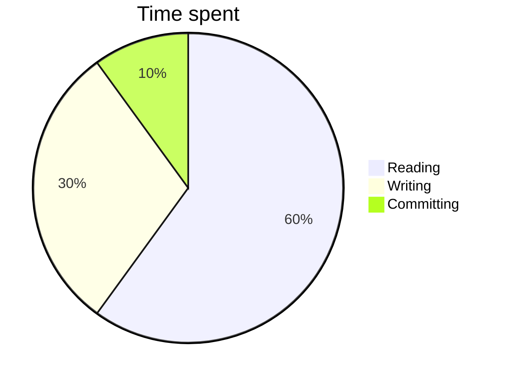
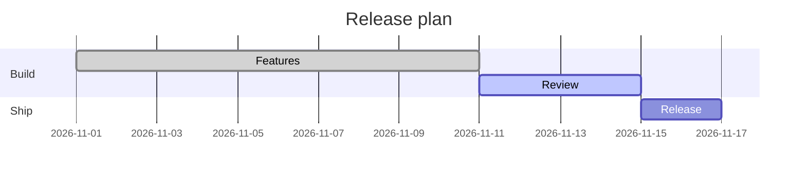

# LexMD Showcase

A tour of everything the preview renders. This demo project is yours to explore and edit: open the **Outline** (⌥⌘O) to jump between sections, and switch to **Preview and Editor** (⌘2) to see the source side by side. When you are ready, choose File > Open… to open your own project. Help > Open Demo Project brings this back any time.

## Text

Plain text with **bold**, *italic*, ***both***, ~~strikethrough~~, `inline code`, and a [link to Apple](https://www.apple.com). Keyboard keys: <kbd>⌘</kbd> <kbd>⇧</kbd> <kbd>P</kbd>.

Links inside the project work too: [the notes index](notes/Index.md), a heading in this document ([jump to Diagrams](#diagrams)), and a heading in another document ([Reading list](notes/Reading.md#next-up)).

Wiki links resolve by name: [[Index]], [[Reading|my reading list]], and [[Reading#Next up]]. A wiki link to a page that does not exist looks different: [[Missing Page]].

> Blockquotes stay quiet and readable.
>
> > Even when nested.

---

## Callouts

> [!NOTE]
> Useful information the reader should know.

> [!TIP]
> A helpful suggestion for doing things better.

> [!IMPORTANT]
> Key information needed to succeed.

> [!WARNING]
> Something that needs attention right away.

> [!CAUTION]
> The risks of a particular action.

## Lists

- Unordered item
  - Nested item
    - Deeper item
- Another item

1. Ordered item
2. Second item
   1. Nested ordered item
3. Third item

### Tasks

- [x] Render diagrams with Pele
- [x] Typeset math with KaTeX
- [x] Footnotes and front matter
- [ ] Write the next great document

## Tables

| Feature        | Where            | Shortcut |
| :------------- | :--------------: | -------: |
| Open Quickly   | File             | ⌘P       |
| Find in Files  | Edit > Find      | ⇧⌘F      |
| Outline        | View             | ⌥⌘O      |
| Export as PDF  | File             | ⇧⌘E      |

## Code

```swift
struct Greeting {
    let name: String

    func render() -> String {
        // Comments are highlighted too
        "Hello, \(name)!"
    }
}
```

```python
def fibonacci(n: int) -> list[int]:
    a, b = 0, 1
    result = []
    for _ in range(n):
        result.append(a)
        a, b = b, a + b
    return result
```

```json
{ "app": "LexMD", "version": "1.0.0", "features": ["diagrams", "math", "tabs"] }
```

```bash
lexmd ~/Projects/docs
lexmd --new idea
```

## Diagrams

Mermaid blocks render as diagrams, in light and dark.

### Flowchart



### Sequence



### State



### Class



### Pie



### Gantt



## Math

Inline math sits in the text: Euler's identity $e^{i\pi} + 1 = 0$, and the area of a circle is $A = \pi r^2$. Prices like $5 and $10 stay as plain text.

Display math gets its own line:

$$
\int_{-\infty}^{\infty} e^{-x^2}\,dx = \sqrt{\pi}
$$

A `math` block:

```math
\begin{aligned}
\nabla \cdot \mathbf{E} &= \frac{\rho}{\varepsilon_0} \\
\nabla \times \mathbf{B} &= \mu_0 \mathbf{J} + \mu_0 \varepsilon_0 \frac{\partial \mathbf{E}}{\partial t}
\end{aligned}
```

## Footnotes

LexMD renders footnotes[^1] with links back to where they were used[^note].

[^1]: Like this one.
[^note]: Footnotes can have **formatting** and [links](https://example.com).

## Images

A local PNG next to the document:


A local SVG:


## Details

<details>
<summary>Click to expand</summary>

Hidden content, revealed on demand. It can hold **Markdown** too.

</details>

## Broken links

These show up in the outline's **Problems** section and are marked in the preview:

- [A missing document](notes/does-not-exist.md)
- [A missing heading](#no-such-heading)
